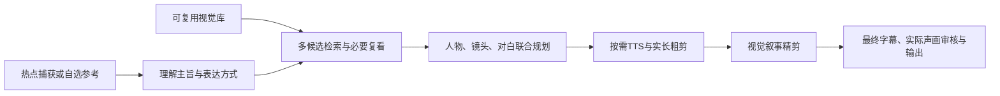

# Agentic Video

从热点或自选参考视频出发，在已有素材库中创作新的短视频：理解参考的表达方式，检索可用画面，规划人物、镜头和对白，生成配音，完成粗剪、精剪与字幕。

素材不必讲述与参考相同的原故事。系统复用真实人物、动作和场景，通过新的组合与 TTS 表达参考的主旨。动作、反应、细节和环境镜头也参与叙事。

系统输入输出、冻结测试集、粗剪基线与完整流程的对照方法，以及产出率、独立声画评分和成本口径，见[系统评测协议](docs/SYSTEM_EVALUATION.md)。`omni-eval` 提供清单校验、资源受限批量执行、独立评测和逐任务报告。[首轮40项探索性结果](docs/EVALUATION_PILOT_20261019.md)已结算：10个实际视频均完成外评，严格自动合格0/40；另有20个确认输入已冻结但未运行。当前结果不支持稳定无人值守或完整版优势的结论。

## 功能

- **自动选参考**：获取近期抖音挑战，比较多位作者的实际声画，识别共同玩法，挑选适合当前素材库的参考。
- **可复用视觉库**：按来源与时间记录人物外形、动作、物件、空间关系和条件用途。新参考先查库，只补看影响选材的局部。
- **参考驱动创作**：保留参考的主题、反差和表达形式，支持角色对白、旁白、混合及纯音乐视频。
- **声画联合规划**：先建立文稿和镜头覆盖，再按 TTS 实际时长排时；已收到的观察与音频可复用。
- **视觉叙事精剪**：选择关键变化，执行裁切、变速、停留，最终添加字幕并审核实际成片。
- **可选并发**：不同参考使用独立编辑进程，共享采集缓存；按内存和磁盘预算控制实际并发，渲染单独限流。



## 安装

服务器后台作业需要 Linux。建议 Python 3.13、Node.js 22、FFmpeg/FFprobe 和中文字体。模型连接使用 OpenCode 与官方 GLM 视觉 MCP；TTS 和实际声画审核使用配置的 Qwen 接口，视频处理可用 CPU。

```bash
git clone https://github.com/Seven-creater/agentic-video.git
cd agentic-video
python3.13 -m venv .venv
. .venv/bin/activate
pip install -e ".[library]"
```

私有运行目录通过 `OMNI_SERVER_HOME` 指定，保存配置、媒体、模型和任务记录。详见[服务器运行](docs/OPERATIONS.md)，这些文件不进 Git。

## 使用

### 自动捕获一个热点并创作

```bash
omni-hot-video start
```

### 批量创作，自己选择并发数

```bash
# 示例：总共制作10条，最多同时编辑2条。
# dry-run只查看资源容量，不捕获、不请求模型。
omni-hot-video batch --count 10 --concurrency 2 --dry-run
omni-hot-video batch --count 10 --concurrency 2
```

`--count` 是总任务数，`--concurrency` 是期望并发数，默认 2、可选 1–32。实际并发还会按内存、磁盘预算下调。默认保留 2GiB 磁盘，每条任务预留 512MiB 输出与 1GiB 内存，同时只运行一个 FFmpeg。32 是代码允许的配置上限，不表示任何服务器都能承载 32 路。

并发版本已完成离线调度与资源边界验证，尚未进行扩容后的真实多路模型端到端验证。参数和停止行为见[并发与空间管理](docs/OPERATIONS.md#并发与空间管理)。

### 自己指定参考

```bash
omni-server start \
  --reference /srv/media/reference.mp4 \
  --library /srv/media/movies \
  --visual-library /srv/agentic-video/shared/visual_library \
  --creative-audio \
  --asr-model-dir /srv/models/faster-whisper-small \
  --output /srv/agentic-video/shared/jobs/my-video
```

### 建库和检索

```bash
omni-visual-library build --home "$OMNI_SERVER_HOME" \
  --library /srv/media/movies --store /srv/agentic-video/shared/visual_library \
  --output /srv/agentic-video/shared/jobs/library-build

omni-visual-library search --store /srv/agentic-video/shared/visual_library \
  --query "拒绝 递交物件 惊讶反应" --limit 30
```

本地检索不发模型请求。首次建库会调用视觉模型；新素材需要建立对应记录。

## 输出与控制

启动命令返回 `job_id` 和 `output`，任务脱离 SSH 后继续运行。

```bash
omni-hot-video status --output "$OUTPUT"
omni-hot-video logs --output "$OUTPUT"
omni-hot-video stop --output "$OUTPUT"
```

单条任务的 `hot_result.json` 指向视频、参考来源、内容状态和用量记录；批量任务的 `batch_result.json` 列出各条独立输出。粗剪和精剪保留原文件，结果未知的请求不自动重发，已收到的结果不靠删除状态重新计费。

## 实现与边界

这是已完成真实服务器剪辑的研究原型。自动热点捕获也已接到精剪和声画审核，但素材适配、角色一致性和视觉叙事质量仍可能有缺口；正常退出不保证创作质量。模型采样不等于逐帧看懂，也不承诺逐音素口型同步。三个近期独立作者示例用于识别同款，不代表统计了全平台所有参与者。

不同参考采用不同声音策略：对白参考优先保留角色视角，音乐参考可以没有 TTS；字幕在最终语音时间确定后添加。无法表达关键动作时保留失败或候选状态。

配音客户端通过 HTTPS SSE 接收合成结果，完整结果到达后结束读取，不再等待长连接关闭；超时仍保留未决记录。创意音频流程先执行静音画面盲审，再审核真实声画，并在最终字幕烧录后检查完整画布的构图、字幕、变形与片尾内容。模型检查仍可能误判，原片对照及人工复核应保留原始审核记录。

仓库发布当前入口、运行所需模块、模板、文档和必要测试。旧实验运行、独立启动器、旧方案文档、电影、成片、模型和私密配置不随仓库上传。少量兼容模块仍是当前运行依赖，不是额外后台任务。

- [架构与数据流](docs/ARCHITECTURE.md)
- [服务器配置、并发、磁盘和结果](docs/OPERATIONS.md)
- [服务器公开网页采集与运行限制](docs/PUBLIC_CAPTURE.md)

## 开发

```bash
pip install -e ".[library,test]"
python -m pytest -q
python -m pip wheel . --no-deps --wheel-dir dist
```

公开入口：`omni-hot-video`、`omni-server`、`omni-visual-library`、`omni-audio`、`omni-eval`。源码位于 `src/omni_story`，模型决策与本地执行分开，媒体和请求记录保存在仓库外的运行目录。
