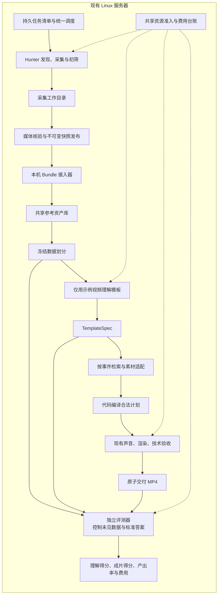

# 模板参考视频接入与评测架构

日期：2026-10-24。状态：服务器基础部署与模板理解评测入口已实现，24 个模板目录、240 条视频已上传；本轮增加可恢复批次与三模板开发试点。使用方法和当前结果边界见 [模板参考上传与评测](TEMPLATE_EVALUATION.md)。

已落地：Claude 接入字段映射、Linux 浏览器 CDP、持久 profile、共享请求预算与回执、上传盘点、冻结划分、稀疏视觉理解、独立声画评审及报告入口；批次复用已有 1024 MiB 隔离与资源准入，由 systemd 托管。服务器相关离线检查通过，三模板试点的原始记录另存。尚未完成新一轮抖音采集、事件驱动制作或实际成片对照；下文相关方案仍是后续设计，不把已安装视为全部验收通过。

分析版本：

- 上游 `douyin_template_hunter`：`dce679ef989ad6a66d9e2b713f01975949d2e737`。
- 下游 `agentic-video`：`a53b41645400f27f97e771ae44e5db75e6641a93`。
- 本地上游仓库：`/Users/Admin/Desktop/agentic_video_all/douyin_template_hunter`。

## 1. 核心决定

**采集、模板理解、素材检索、视频制作与评测全部在现有 Linux 服务器运行。** Hunter 负责提供参考视频，视频系统负责理解和迁移，评测器独立检查结果；模块分工不意味着分到不同电脑运行。

接入单位从“一个热点下的一条视频”升级为“一个模板的一组参考视频”。先补稳定的数据交付边界，再补多参考理解，不重写已经验证过的渲染、声音、台账和资源控制。

| 决定 | 采用方式 |
|---|---|
| 部署 | 同一台 Linux 服务器，采集、制作、评测分进程托管，共享资源准入与费用台账 |
| 初版接口 | 本机持久任务清单调度采集；以不可变 Bundle 和按哈希寻址的媒体交付；HTTP API 为可选封装 |
| 数据身份 | 视频用平台 ID 加文件 SHA；模板用持久 ID；文件编号仅作显示 |
| 理解输入 | 同模板的若干示例；评测先划分示例与未见样本，再做模板归纳 |
| 模板表达 | 有证据的关键事件、角色关系、顺序、可替换元素与声音节点 |
| 生成方式 | 事件驱动检索、合法候选选择、代码编译计划，复用现有声画交付 |
| 评分 | 工程完成、模板理解、成片质量分别报告；采集端审核不能直接当成成片评分 |
| 实施规模 | 先完成无付费的数据接入回归；小样本试点评测另行启动，不恢复已取消的 20 条重测 |

## 2. 仓库实际具备什么

已阅读核心 CLI、采集、浏览器、模型调用、验收、去重、存储、分析，以及辅助脚本和规则文档。下表保留接入前的源码检查结论；此后的 Linux 适配、接入验证及上传数据检查另见实施记录。没有据此宣称抖音登录或新一轮采集已经验证。

| 能力 | 当前实现 | 接入含义 |
|---|---|---|
| 调用方式 | `python -m hunter` 的 `hunt / batch / scout / analyze / status` | 当前没有 HTTP API、服务地址或异步任务 API |
| 浏览器运行 | Edge + 本地 CDP；优先 Windows 路径，另尝试 PATH 中的 `msedge` | 需补 Linux 浏览器路径、显示环境、扩展加载与持久登录态适配；当前代码尚不能直接视作已部署的 Linux 服务 |
| 发现模板 | `scout` 筛热词，再依据标题、作者昵称和时长判断生态，写 backlog | 是候选发现证据，不等于逐视频画面已验证；代码未把 backlog 自动串成注册、采集、分析闭环 |
| 视频采集 | 搜索、详情页、话题页、原声页、分享链接导入 | 可以作为上游资产提供方；外部搜索仍含会话工具参与，不能宣称全自动服务已完成 |
| 样本审核 | 抽帧后调用 GLM，判断模板匹配和演绎形式 | 结果是筛选意见；不代表模型真正听到了音轨 |
| 数据保存 | `data/NN_模板/01.mp4...`、`metadata.json` | 能导出资产；尚不是稳定、完整的交付契约 |
| 分析 | 逐视频摘要后综合成 `analysis.md` | 可辅助人阅读，不能直接当结构化计划或评测标准答案 |
| 已有数据 | Git 仓库不包含 `data/` | clone 得到代码，不会得到另一台电脑上的参考视频 |

上游规则文件用于了解该仓库的设计意图。其中的历史采集数量、删除规则和授权描述，不自动成为本次执行指令。本文也不把文档里的成功率、限流观察或热门数据当作本次实测结果。

## 3. 必须在边界上解决的差异

| 源码事实 | 影响 | 架构处理 |
|---|---|---|
| `store.remove_videos()` 重排编号；`analyze_folder()` 按文件名缓存摘要 | `02.mp4` 改成另一个视频后可能命中旧摘要 | 导出不可变快照；缓存绑定媒体 SHA、模型、提示词和抽帧配置；旧摘要无绑定时不自动复用 |
| `save_meta()` 直接写 JSON；没有统一的采集／发布事务锁 | 读取时可能遇到半写入文件、媒体与清单不同步 | 发布方与写入方共用锁，复制并核对后原子发布；消费者只读已发布快照 |
| `TemplateStore.add()` 没保存完整审核回答、请求回执及 `music_id`；作者仅昵称 | 无法从“在文件夹里”推断审核通过、不同作者或同一音乐 | 缺失字段标 unknown；补证据输出，不补造；稳定作者 ID、音乐 ID 有则保留 |
| 分享链接导入忽略审核通过与否，异常时还会填默认形式；CLI 可 `--no-verify` | 同一个目录可能混有不同准入来源 | 明确记录自动审核、人工确认、未验证；旧数据默认 `unverified_legacy`，不伪装自动通过 |
| 规则文档区分 A 族对手戏与 B 族单人句式，但 `verify.py` 第二关仍统一要求画面内对手 | B 族可能被错误拒绝 | 自动采集服务化前补族别分流；下游不能沿用该统一审核作为真值 |
| `analyze.py` 从全目录最多十条生成综合结论 | 若随后把其中几条当未见测试，会泄漏答案 | 先冻结划分；理解器仅见 support；完整分析报告隔离保存 |
| Hunter 的音乐判断只基于图片与元数据，还要求推测节奏 | 不能据此评测真实音乐卡点或声画一致性 | 音频分析独立读取实际音轨；推测与观察分开保存 |
| 下载流程允许音频合并失败后保存无声视频 | MP4 存在不等于声音可用 | 导入时探测、解码、测量声音；有视频资产与可做声音任务是两个状态 |
| `glm.ask()` 遇网络异常会自动重发；没有本项目的付费请求台账 | 超时后可能重复付费，与当前未决保护不一致 | 启用服务器采集前接入已有请求登记、费用预留和未决隔离，涵盖探活、发现、审核、去重与分析 |
| 并行异常分支使用 `setdefault(id, _dl_verify(c))`；语义查重并发共用 `cand/` 抽帧目录 | 前者默认参数会先求值，可能重做验收；后者可能相互覆盖帧 | 服务器自动采集启用前修复；现有去重结果仅作线索，不能直接保证评测集无泄漏 |

这些问题通过有限的服务适配解决，不要求重写 Hunter。实施时可以先用保存的数据验证快照契约，但正式目标包含服务器自动采集，不能把人工传入视频包当作完成整条接入。

## 4. 组件与部署



### 4.1 服务器负责完整链路

由服务器调度器串起 `scout → 候选模板登记 → hunt → 审核与封存 → 理解 → 制作 → 评测`。目前 `scout` 只写 backlog，因此需要补上候选登记及后续任务提交；候选发现不直接当作审核通过。每一步保存身份和状态，进程重启从已完成阶段继续。

采集、制作、评测由 systemd 分进程托管，进程可独立恢复。电脑用于开发和查看结果，关闭电脑不影响服务器任务。采集暂时受阻时，已有完整快照的独立任务仍可继续；需要实时新数据的任务等待，不把旧快照标成新热点，也不自动启用旧热点抓取链路。

初版不引入消息队列平台。持久 JSON 任务清单、原子发布、文件锁和现有调度器足够；同机先用 CLI／模块接口提交任务，无需为内部传文件额外搭建网络服务。

### 4.2 Linux 浏览器与登录态

浏览器可执行文件、CDP 地址、显示环境及 profile 路径改为显式配置。先验证 Linux 浏览器与现有注入扩展、CDP 采集逻辑的兼容性；不能只替换 Windows 路径就宣称完成适配。部署方案优先验证虚拟显示环境中的有界面浏览器，是否可切换无头模式由实际采集结果决定。

登录态保存在服务器持久目录，如 `shared/browser_profiles/hunter/`，不再用临时目录承载正式 profile。首次登录或会话失效可能需要远程交互完成；日常采集不依赖本地电脑常开。认证失效记录为 `blocked_auth`，不能通过不断重启或重复付费审核掩盖。

CDP 只绑定回环地址；profile 与密钥限制文件权限，不进 Git、不进入 Bundle。可选 HTTP 接口默认也仅本机访问，日后开放远程访问再加认证。消费者只解析受限清单和资产 ID，不执行上游传来的命令、任意路径或下载 URL。

### 4.3 采集与制作共享资源预算

默认一个浏览器 profile、一路采集，下载与模型审核并行度改为可配置，初期从 1 开始。制作并发上限仍为 5、每路 1024 MiB 硬限，实际同时运行数量由剩余资源决定；上限 5 不等于采集浏览器和 5 路制作可以无条件同时启动。

统一准入在同一把锁下登记浏览器及其子进程、制作 worker、评测进程的资源占用。浏览器单独设置可配置的内存预算和进程组限制，具体额度依据服务器实测确定；浏览器仍存活时不得释放预留。FFmpeg 操作沿用全局渲染限流，采集下载、临时音视频合并与评测代理文件也计入磁盘预留。资源不足先排队，必要时交替执行采集与制作。

这部分需要扩展现有资源模块。目前的 worker 保护不能自动覆盖新增浏览器；实施时必须验证跨模块同时申请资源、浏览器退出回收、磁盘不足等待和单任务失败隔离。

## 5. 数据契约：ReferenceBundle v1

**一个 Bundle 表示一个模板在某个时间冻结的一组资产；不要求必须凑满十条。** 样本不足如实记录，能否用于某个任务由任务协议决定。

| 层级 | 必需字段与含义 |
|---|---|
| 清单 | `schema_version`、`producer_id`、`producer_commit`、`published_at`（带时区）、`template_id`、`template_name`、`videos` |
| 模板 | `declared_family: A/B/unknown`；可附上游描述、筛选规则摘要与版本，但只是来源声明 |
| 视频身份 | `platform`、`platform_video_id`、`asset_sha256`、`byte_size`、`media_type`；`01.mp4` 只是显示名称 |
| 来源 | `page_url`、采集方式、原始标题；`creator_id`、`music_id`、发布时间、采集时间无法确认时填 null |
| 媒体事实 | 时长、画布、帧率、音轨信息来自探测；消费者再次验证。声音类别未知时不能猜成纯 BGM |
| 准入证据 | `curation_status`、`evidence_refs`、审核模型和规则版本；状态包括有回执的自动审核、有记录的人工确认、旧数据未验证、拒绝 |
| 重复线索 | 内容 SHA、感知指纹与可选源素材簇 ID；附算法版本及置信状态，不用昵称推断独立作者 |
| 可选分析 | 上游摘要文件及哈希，标为 `producer_analysis`；与可供理解器读取的输入隔离 |

规则：

1. `template_id` 由发布方生成并持久保存，改名或目录重排不变；跨发布方的同名模板先不自动合并。
2. `bundle_version` 是规范清单文件实际字节的 SHA，放在外部索引／响应头，避免清单自引用。临时下载凭据不参与清单版本。
3. 视频身份使用平台 ID 与文件 SHA：同 ID 内容变了就是新版本，不能覆盖旧快照。
4. 旧 `added_at` 没有时区，不擅自转换成精确采集时间；保存原值，另记录真实导出时间。
5. 发布器与 `store` 写入共用锁。媒体封存、哈希、数量核验完成后，最后原子发布 manifest；未完成目录对消费者不可见。未加写锁的旧工作目录只能在停止采集后导出。
6. 采集工作目录的删除、重排或黑名单更新不会覆盖已冻结实验。新发布状态影响新任务；旧实验保留版本与撤回说明以便审计。
7. Hunter 自身审核不足的旧数据可以进入探索区，不能未经补标就声称是干净评测集。数据标注与运行中人工干预分别统计。

同机以本地 Bundle 为正式边界。以下只读 API 可作为未来调用方需要时的封装，不是本次服务器部署的前提：

| 接口 | 行为 |
|---|---|
| `GET /v1/capabilities` | 协议版本、producer commit、导出能力、大小限制；不触发探活付费调用 |
| `GET /v1/templates?cursor=...` | 模板 ID、族别声明、可用快照及状态；稳定分页 |
| `GET /v1/templates/{id}/snapshots/{version}/manifest` | 获取精确版本的不可变清单，可用 ETag 校验 |
| `GET /v1/assets/{sha256}` | 返回已保存的媒体字节；可支持断点续传，禁止按请求临时重新抓取抖音 |

**以上均为待实现接口。** 正式采集由本机调度器提交持久任务并启动 Hunter，不能等待一个尚未实现的 HTTP 写接口才接上自动流程。以后需要 `POST collection-jobs` 时，仅返回持久任务 ID，不能用同步长请求包住整个 `hunt`；底层仍复用同一调度和费用保护。

只读获取失败允许有限重试；协议版本不支持、身份校验失败、指定快照不存在或内容哈希不符时，返回明确错误，不自动改用 latest。分页游标绑定目录视图；实验任务一旦选择快照，后续只读取该精确版本。

参考媒体统一放在服务器 `shared/reference_assets/`，下载先写受预算约束的 `.part`，核验后按内容 SHA 原子封存。下游按 SHA 读取同一份文件，不经 HTTP 再下载一份。采集工作目录只持有引用；不可变资产不得与可被原地修改的旧工作文件共用可写硬链接。旧目录迁移时在锁内复制并核验一次。导入回执绑定 Bundle、媒体、探测结果与接入器版本；重导同一快照不得重复下载、重新分析或生成第二份任务。

资源策略沿用保留 2 GiB 磁盘余量、已有 worker 磁盘预算和每路 1 GiB 内存硬限，再为采集及评测加入统一预留。只下载本轮采集清单需要的视频，限制单文件大小、单任务总下载量和未消费参考的占用；入库前计算临时文件空间，下载中持续检查上限。媒体超大小限制明确隔离，不先静默转码冒充原件。清理只针对可重建缓存或无活跃任务／冻结实验引用的副本，不动电影、自建素材库、台账和 provenance。

## 6. 从视频组到可执行计划

### 6.1 两种理解模式

- **生产辅助模式**：允许参考上游模板描述，但标记其来源，仍须用视频证据验证。
- **理解评测模式**：仅给冻结的示例媒体，不给有答案的模板名称、定义、全量分析、未见视频摘要。标题等文本如需提供，作为另一种公开声明的实验条件。

`template_id` 负责路由，不把“赵德汉藏钱”这样的明示答案当作盲测输入。模型既有常识无法完全消除，但不能再把正确脚本写进提示词后声称它从视频理解出来。

### 6.2 TemplateSpec v1

限制为五类内容，使用短结构，不设计任意大图谱：

| 内容 | 表达方式 |
|---|---|
| 核心机制 | 一句可迁移的表达目标，如“外表朴素与隐藏财富之间的反差” |
| 事件与顺序 | 3–8 个事件，每项有角色、动作／状态、前后关系、是否必需；句式型允许使用文案递进节点 |
| 保留与替换 | 哪些关系不可少；哪些人物、地点、物件可以替换；必要时标明固定句式和允许改写部分 |
| 声音节点 | 对白／纯音乐／混合原声／未知，及其与事件的对应关系；必须来自实际音频证据 |
| 证据与不确定性 | 每项绑定示例视频 SHA、时间范围、观察方式与支持／反例；分开记录观察和推断 |

样例（解释结构，不是现有评测标签）：

```text
角色：隐藏秘密的人、揭露秘密的人
b1：前者表现平常／朴素
b2：后者展示与这种形象矛盾的证据
b3：前者情绪或行为发生明显变化
必要顺序：b1 → b2 → b3
允许替换：身份、地点、隐藏物
不允许：只靠字幕声称已经揭露，画面没有对应事件
```

模板族别影响评分：A 族重点看角色互动与冲突；B 族看句式递进、情绪和收束，不强制双人出镜。“转折必在 60%–85%”只能作为上游经验，须由具体模板示例验证，不能固定为所有模板的规则。

现有抽帧描述不能提供真实听觉证据。音频使用实际音轨、可追溯转写／音频分析，保留时间基准；没有可靠证据时声音字段为空并说明原因，不让模型从图片猜出音乐节拍。

### 6.3 素材适配与计划编译

1. 对每个必需事件生成检索需求，从现有 verified observations 检索合法片段。
2. 生成 `beat_candidates`：事件 ID → 候选片段 ID、角色／动作支持、合法区间和原证据。
3. 输出 `material_fit`：能支持哪些事件、缺什么，以及角色连续性或对白能力的限制。
4. 模型只选择并排序已验证候选，提供事件对应关系；时间量化、画布、区间、片段身份继续由代码编译。
5. 声音计划沿用已有音源与 TTS 台账。需要新配音但无合法配音结果时按既有规则降级，记录模板语义可能受损。
6. 复用声音、渲染、技术验收和原子交付。计划要保留 `beat_id → clip_id → source window → output interval`，供评分定位。

**工程降级不等于模板保持成功。** 有合法相关素材与声音、但无法完整体现模板时，可以按现有授权交付降级结果，并在模板指标中记录缺失；完全没有相关素材或合法声音则阻塞。不能用无关镜头加字幕凑齐剧情。

当前执行能力边界必须显式暴露：正式输出仍为 1280×720、30fps、10–180 秒；现有计划实际目标最多 60 秒，配音最多 3 句、每句 24 字。短参考或长对话模板可能与这些限制冲突。初版报告能力缺口；后续若要支持 7 秒成片或完整长对白，另建版本化执行配置并验证，不在一次实验中暗改上限。

## 7. 代码如何接入，避免再造一套系统

### 第一步：服务器采集与资产接入，保持生成核心不动

先在 Hunter 补 Linux 运行配置、持久任务入口与统一请求保护，接入现有调度器的资源准入。新建 `reference_sources/hunter.py`，默认从服务器本地目录读取 Bundle，输出已核验资产及回执；可选 HTTP 传输复用同一解析器，不影响理解与生成代码。

初次链路验证按冻结规则选择一个示例，转换成当前 `input_kind=reference`，直接交给 `reliable_v1`。这是“外部参考接入验证”，不声称完成了多参考模板理解。

### 第二步：模板理解与迁移

新增少量职责明确的模块：

| 位置（拟新增／修改） | 职责 |
|---|---|
| Hunter 的 `browser.py`、CLI、`glm.py`、`store.py` | Linux 浏览器与持久登录态、可恢复采集任务、付费调用保护、原子快照发布；修正现有并发重复调用和临时目录冲突 |
| 现有调度与资源模块 | 登记采集浏览器、制作和评测的共同资源占用，按依赖推进任务；同一 profile 串行、资源不足排队 |
| `reference_sources/hunter.py` | 获取、校验、缓存 Bundle；不调用 Hunter 的 GLM 客户端 |
| `library/template_spec.py` | 模板契约、证据校验、提示词使用同一契约 |
| `library/template_transfer.py` | 示例理解、事件检索、素材适配和片段选择；使用现有 Checkpoints、LibraryState 与预算模块 |
| `library/reliable.py` | 把已验证的“合法计划 → 声音／画面 → 验收／交付”抽成共享入口，原 reliable_v1 继续调用；保留原模式行为 |
| `library/reliable_cli.py` | 增加受控模式分派、模板输入身份与状态归集，沿用同一协调器、cgroup、资源排队和进程恢复 |
| `evaluation/template_protocol.py` | 任意显式数量的模板任务、数据划分、评分配置与冻结身份 |
| `evaluation/template_judge.py` | 各任务输入隔离、实际声画评分、回执及汇总适配 |

新模式命名为 `template_transfer_v1`；新输入、模式、输出路径、模型请求身份和恢复检查点一起版本化。旧 `reliable_v1` 批次、结果字段和已收到调用的身份不改写。

现有评测不能原封不动复用：`evaluation/manifest.py` 固定 20 个 heldout 与两种方法；`judge.evaluate()` 依赖旧 worker 状态和 `chain_result.json`。新协议单独解析，再复用底层音视频评审、回执校验、预算和统计工具，不能把新的 `reliable_result.json` 硬塞成旧批次成功。

## 8. 评测协议

### 8.1 先划分，再理解

实验清单冻结：Bundle 版本、媒体 SHA、模板族别、support/query 划分、任务类型、标准答案、方法、库版本、代码／提示词／模型版本、声音策略、预算、生成次数与阈值。

建议最小试点为 3 个模板（覆盖 A/B），每个 6 个经数据核验的独立实例：4 个示例、2 个未见实例。样本不足就记录不足，不用近重复视频填满。该数量只是后续试点建议，本次不执行，也不作为统计显著性的依据。

划分先按内容与近重复素材成组，整组分配到同一侧；仅按作者昵称或文件编号随机划分不够。共同 BGM 可以出现在同模板测试中，但这种结果不能声称验证了“未见音乐泛化”。后者需要另做跨音源划分。

理解器只能访问 support 的受限输入清单。query 的完整视频、字幕、音频、上游全量报告和标准答案只给评测器；截断预测题实际裁剪输入画面和声音，不能只告诉模型“忽略后半段”。

先做“同模板新实例”泛化；以后才做“从未开发过的新模板”泛化，两者独立报告。用同一批模板调提示词后再测新实例，不能宣称是新模板测试。

### 8.2 五类问题和分数

| 任务 | 输入／输出 | 主指标 |
|---|---|---|
| 模板理解 | 示例组 → TemplateSpec | 必需元素覆盖、事件顺序、无证据主张比例 |
| 后续预测 | 示例归纳 + 未见视频前缀 → 后续事件 | 对可接受后续的事件 F1、必要顺序正确率；另报告简单“预测模板常见后续”基线 |
| 情节检索 | 模板 + 冻结的故事／素材候选 → 排序结果 | Recall@5、首个相关结果倒数排名、必需事件可用素材覆盖率 |
| 声音与剧情 | 模板背景 + 实际音频片段 → 剧情阶段；或成片 → 声画节点 | 阶段准确率、卡点绝对误差中位数、预先声明容差内的比例 |
| 最终成片 | 模板标准 + 实际 MP4 → 独立评分 | 模板保持分、现有五维质量分、工程与质量联合产出率 |

模板要素用 `0/1/2`：缺失或错误／部分体现／明确体现；必需项权重 2、可选项权重 1。分数为：

```text
TemplateScore = 100 × Σ(权重 × 单项得分) / (2 × Σ权重)
OrderAccuracy = 正确体现的必需先后关系数 / 全部预定义必需先后关系数
UnsupportedRate = 被核定无证据的主张数 / 已核定的 supported 与 unsupported 主张数
ClaimVerificationCoverage = 已核定主张数 / 全部候选主张数
```

没有输出时 TemplateScore 为 0；没有可核验主张时 UnsupportedRate 标不可计算，不能拿“没有胡说”充当理解成功。遗漏事件对应的先后关系按未正确体现处理，不从分母删除。

同一要素表分别给“理解结果”和“最终视频”评分：前者看描述及引用证据，后者必须在实际成片找到声画证据。两者的差距帮助定位理解、检索还是制作损失。

最终质量继续使用 1–5 分的主旨迁移、叙事／表达完整性、声画配合、剪辑节奏、观看体验。保留旧锚点以便解释，但新任务的通过阈值要在开发样本校准后冻结；初版先报告各项原始分，不临时选阈值凑通过率。

评分器须附实际时间戳证据，不能只读计划判断“画面已经实现”。纯 BGM 没有配音不扣分；混合原声不可冒充纯音乐。没有实际音频证据的音乐题不能评分。预先不适用的任务标 N/A；已经计划但因缺音频无法执行的任务记阻塞并保留分母，同时报告覆盖率。

### 8.3 评分可信度与对照

- 上游筛选答案不直接当金标准。少量人工标注确定核心要素与允许变体，模型可提出其他合理解释；争议仲裁留记录。
- 自动评审不知道方法名、不看生成时的自评与推理；只看任务所需输入及实际结果。首轮少量人工复核用于检查偏差，不能声称完全客观。
- 同一模型筛选、理解和评分可能产生共同偏好。记录模型来源；优先使用独立声画评审通道，并说明“独立请求”不等于“独立模型家族”。
- 第一组对照：现有单参考 reliable_v1 对比多参考模板模式，同一素材库、输出规格、预先选定输入和调用预算，默认每方法每模板只生成一次。
- 这个对照同时改变了参考数量与模板表达，不能把提升全归因于结构化模板。需要归因时再加“同数量参考但只输出平面主题／检索词”的消融条件。
- 禁止看结果后挑最好的一条。若以后测试多次采样，预先冻结次数，所有调用计费，并同时报告全部结果与选优方法。
- 检索先复用现有电影观察与合法片段做标注。合成小说可做便宜的辅助诊断，但不替代真实素材检索结果。
- 汇总先逐模板，再对模板取平均，防止样本多的模板淹没其他模板；只有三个模板时报告计数与范围，不宣称显著提升。

### 8.4 最终报告的分母

```text
工程出片率 = 技术通过并原子交付的任务数 / 冻结计划任务数
模板合格产出率 = 工程通过且达到冻结模板门槛的任务数 / 冻结计划任务数
质量联合产出率 = 工程、模板与成片质量均通过的任务数 / 冻结计划任务数
```

同时报告：正常／降级／阻塞／失败、素材缺口、评测覆盖率、自动恢复、运行中人工干预、耗时、付费调用数与累计费用上界。无法生成、外部拒绝、预算停止、素材不足都留在预先计划的分母中。

可以另报告“在具备完整素材的子集上的结果”，但子集条件必须事先定义，并与全体结果并列。数据集标注、运行中救场、用户取消分别计数。

## 9. 运行状态、恢复与费用

采集任务：`queued → scouting → collecting → verifying → sealing → ready`；单个资产记录下载、媒体核验、审核与发布状态，不合法则 `quarantined`。`ready` 必须引用实际发布的 Bundle，不能只看 CLI 退出码。认证失效、资源不足、预算不足分别记录原因；无法自动恢复的依赖不反复重启尝试。

生成：`queued → understanding → retrieval → planning → picture → sound → technical_check → delivered`，另有 `blocked/failed`。每个阶段保存输入身份、产物哈希和检查点；systemd 重启只唤醒同一个持久任务，不产生新请求身份或重复交付。

质量评测是交付后的独立状态，不把技术 completed 改成质量合格。来源资产缺失、输入变更或版本不符直接阻塞，不重新抓一个不同视频顶替原任务。

同一任务身份绑定实验 ID、Bundle SHA、support/query、方法、素材库版本、代码／提示词版本与输出配置。目录改名、重复 API 提交、进程重启均不产生新付费身份。收到的结果复用；已知暂时性失败按有限策略处理；未决请求保持隔离与费用预留。

未决调用只阻塞依赖它的付费操作，其他独立任务按剩余预算继续；如能使用已有合法素材安全降级，则记录降级而不重发。不能把旧评测器的整批 unknown 检查机械搬过来，也不能删除旧 unknown 保护来放行新协议。

当前累计 100 元授权不能因为多一个模块而重新获得 100 元。服务器上的采集审核、模板理解、TTS、自动评审均纳入已有预算链；本次设计不产生新业务 API 调用。另一台电脑过去的采集费用无法从此代码仓库得知，应列“历史外部成本未知”，不能计成 0。

同机使用唯一的费用登记入口，复用现有预算文件、文件锁与预留机制，不另建分布式费用服务。Hunter 每次付费 POST 前必须登记请求并预留额度，包括自动探活、候选发现、审核、去重和分析；完成后保存回执。网络中断导致未决时，不能由另一个 worker 或重启进程重发。台账不可用时停止新的付费调用，已完成资产仍可交付。

## 10. 实施批次与验收交付

| 顺序 | 工作 | 可以检查的交付 |
|---|---|---|
| P0 | 适配 Linux 浏览器与持久 profile；接入费用保护、共享资源准入和服务托管 | 明确服务器运行配置；验证浏览器生命周期与资源回收、任务去重、未决不重发；已有响应可用于离线回归 |
| P1 | 稳定身份、快照发布、Bundle 导入，串起发现与采集，接现有 reliable_v1 | 有界的小型服务器链路验证：采集到真实媒体并发布、制作和交付；重导、重排、哈希错误、缺音轨与进程中断不破坏已有保护 |
| P2 | TemplateSpec、事件候选与编译，建立共享交付入口 | 小量模板理解题、事件检索题及完整输入／输出证据；记录三部电影的具体缺口 |
| P3 | 冻结小型模板评测，接独立评审与报告 | 3 模板建议试点，理解和成片分开；预算内按清单执行，不重开原 20 条重测 |
| P4 | 视效果扩展声音对齐、长对白、其他素材 | 先按已记录缺口扩素材与能力，再扩大样本；新版本保留旧失败 |

当前最小上游交付要求是：**在服务器上可托管、可恢复的采集入口，以及带稳定模板分组、实际媒体、来源和哈希的不可变 Bundle**。两个仓库仍可独立开发与锁定版本，部署到同一服务器后由统一调度器串联。验证应覆盖从采集到交付，不以手动上传一份参考视频替代采集端验收；不需要先建完整 HTTP 服务或重跑原 20 条评测。

## 11. 源码定位与核验范围

上游链接固定到本次分析提交，避免之后更新导致结论与代码错位：

- [CLI 与并行采集](https://github.com/Seven-creater/douyin_template_hunter/blob/dce679ef989ad6a66d9e2b713f01975949d2e737/hunter/__main__.py)：`run_hunt`、`cmd_batch`、`cmd_analyze`、`main`。
- [数据保存与重排](https://github.com/Seven-creater/douyin_template_hunter/blob/dce679ef989ad6a66d9e2b713f01975949d2e737/hunter/store.py)：`save_meta`、`add`、`remove_videos`。
- [摘要缓存与全量综合](https://github.com/Seven-creater/douyin_template_hunter/blob/dce679ef989ad6a66d9e2b713f01975949d2e737/hunter/analyze.py)：`DESC_PROMPT`、`analyze_folder`。
- [模型请求和重试](https://github.com/Seven-creater/douyin_template_hunter/blob/dce679ef989ad6a66d9e2b713f01975949d2e737/hunter/glm.py)：`probe_model`、`ask`。
- [样本验收](https://github.com/Seven-creater/douyin_template_hunter/blob/dce679ef989ad6a66d9e2b713f01975949d2e737/hunter/verify.py)、[语义去重](https://github.com/Seven-creater/douyin_template_hunter/blob/dce679ef989ad6a66d9e2b713f01975949d2e737/hunter/semantic_dedup.py)、[候选发现](https://github.com/Seven-creater/douyin_template_hunter/blob/dce679ef989ad6a66d9e2b713f01975949d2e737/hunter/scout.py)。
- [用户链接导入](https://github.com/Seven-creater/douyin_template_hunter/blob/dce679ef989ad6a66d9e2b713f01975949d2e737/scripts/import_user_links.py)、[浏览器入口](https://github.com/Seven-creater/douyin_template_hunter/blob/dce679ef989ad6a66d9e2b713f01975949d2e737/hunter/browser.py)、[媒体下载](https://github.com/Seven-creater/douyin_template_hunter/blob/dce679ef989ad6a66d9e2b713f01975949d2e737/hunter/fetch.py)。

下游主要接点：`src/omni_story/library/reliable.py`、`reliable_cli.py`、`worker_memory.py`、`state.py`，以及 `evaluation/manifest.py`、`judge.py`、`budget.py`、`report.py`。

架构分析最初阶段只进行了克隆、静态检查和设计修订。上游原提交不附运行数据或测试目录；19 个 Python 源文件在本机 Python 3.9.6 下作语法解析时，辅助脚本 `scripts/scout_reverify.py:40` 的跨行 f-string 未被接受，这只是旧解释器下的兼容性发现。后续服务器部署使用 Python 3.13、已有 Linux headless shell 与 FFmpeg，已补接入和评测回归；具体发布版本及检查收据单独保存，不将旧静态检查描述当成当前部署状态。
