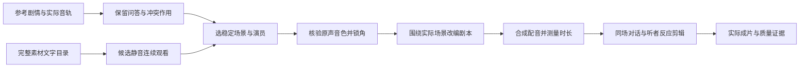

# 已认可创作线路：冻结基线与全模板验收

用户已明确认可本次视频质量。本次工作以保留成片效果、复现创作方法、提高端到端稳定性为目标。已停止针对这部成片追加审美或口型改动。

## 冻结内容

| 项目 | 固定值 |
| --- | --- |
| 基线 | `approved_chiikawa_dialogue_20261114_v1` |
| 创作代码 | `65542a6367d6aa99e7370356f3e7eb0a9f32690252764a4331eb985fdfbbc4b6` |
| 认可预览指纹 | `1c9d31e1e1b97d6b16e3311159fec7a60f5a9880bc9637f8b24bd3f939a247d6` |
| 成片 | 41.433333 秒，1280×720，30 fps，19 句配音 |
| 素材快照 | `20261112_192956_bae89672`，吉伊卡哇素材库 |
| 创作模式 | `reference_story_v1` + `stylized_animation_v1` |
| 原声音色 | 按实际演员独立采样、核听并注册；不借用外形相似人物的音色 |

服务器保存了不可混淆的两套版本：首次自动完成的认可预览，以及后来的技术收尾版本 `a57098c434a2`。源码压缩包、源码逐文件指纹、当次输入锁、剧本、角色绑定、配音、成片、模型原始记录均保留。终审实验保留原始结果，未覆盖创作基线。另建固定入口，独立于服务器 `current` 指针。

## 这次质量好的实际原因

1. **让 GLM 阅读完整目录，再观看候选画面。** 导航阶段提供 1389 个可用窗口的 20 页文字目录，包含视觉概述及可用场景，全部完成分类。源码中的目录分类调用不上传图片或视频；不能据此声称模型已经看过所有原片窗口。随后对入围候选播放遮住原字幕的静音连续视频，比较场景、人物关系、反应与连续性。原先稀疏关键词检索的候选限制由全目录阅读替代。
2. **先找能演对话的场景，再写剧本。** GLM 比较了旧书摊、盔甲角色柜台、动物包摊位等候选，选择同一组人物的连续摊位场景。连续性观察明确区分画面事实、可以通过剪辑增加的意思、可由配音补足的内容。
3. **保留参考的对话作用，允许画面合理替换。** 参考保留完整 36 条台词供对照，主线 32 条作用压缩改编为 19 句；次要路人插曲另列省略理由。商品由西瓜换成包，仍保留问价、嫌贵、保证品质、反复质疑、分量争执、揭穿与反击。无须找到精确的西瓜或秤镜头。
4. **演员、故事角色与音色先绑定。** 当前买方是蓝色头顶白猫，卖方是银灰盔甲角色，白熊是同场无台词人物。采样不足会先反馈给 GLM 调整选角；不为了凑时长临时换声音或借别人的讲话画面。音色样本按演员隔离，避免角色同名时误用另一个演员的音色。
5. **先合成配音，再按真实时长剪画面。** 19 句使用实际合成音频排时，不靠文字长度猜时长。首次发言引出角色，后续允许同场听者反应。约 30 秒的独立源片段通过对话剪辑形成 41.43 秒成片，保持一个场景、稳定演员和音色。
6. **成片事实与终审意见分开。** 可播放、声音存在、字幕和配音时长、角色绑定等可直接核对。终审模型也会把静态牙齿、听者表情或时间段看错；这些原始意见保留，但用户对这部作品的明确认可单独登记，不再为了自动评分反复改坏已认可的成片。

## 全模板测试

现有资料为 24 类模板、每类 10 条，共 240 条参考。用户明确选择本轮只测 24 类、每类 1 条，不执行另外 216 条变体；优先把认可模板从全新入口复测。每个任务使用相同创作代码、素材快照、配置和固定入口；独立输出、独立台账，串行运行。

每条分别记录：是否生成真实视频、完整解码是否成功、是否有声音、角色/音色绑定、参考对话功能与字幕核验、自动质量意见、降级情况、耗时、故障及模型请求状态。实际出片和内容质量分别统计，不能把“进程退出成功”当作“视频质量通过”。失败任务保留现场；未知请求先对账，不重放。通用工程修复使用有版本的入口或候选代码，原认可源码不变。

启动环境的首次全新运行已暴露 `OMNI_WORKER_OUTPUT` 漏传，发生在模型请求之前。固定入口已补齐该任务级环境变量后重新启动，旧失败记录保留。当前完整结果见服务器批次台账和本目录 `latest_batch.json`；本文件不把尚未跑完的批次写成全部通过。

## 本轮发现的通用接口故障

首条冷启动完成全目录后，在缩略图候选返回处停止：原回复把解释附在编号后、后续回复改成对象，并把一个长编号读漏一个字符。已保留原始失败，不猜补长编号。稳定性候选 `ed7e13e0cc7d` 仅修改素材浏览接口：图中改用短行号，精确映射回素材 ID，兼容清楚的编号表示并保留解释；联合编剧、角色、原声和调时源代码不变。33 项接口与目录约束检查通过，实际运行已成功走过该接口。之前20页分类全部复用。原认可代码 `65542a6367d6` 与成片仍不变。

2026-11-14 13:48（台北）：冷启动耗时约 20 分钟参考解析 + 37 分钟全库目录分类；不能将之前复用上游分析后的成功出片视作冷启动端到端已稳定。首条在角色审查中因原场景无摊位/付款而反复否决并换角，触发重复决策停止。通用修复只改变角色审查与协议恢复：不要求证实原职业，仍审实际身份/动作方向矛盾；审核必须回传对应 actor_id；重复已否决分配进入有上限的协议纠正。45 项相关检查通过。候选 cfa455cb57be 从刚失败 evaluation 续跑，不重跑目录。已认可基线 65542a6367d6 保持不变。旧片字节一致硬链接去重释放约 400 MiB，路径和 SHA 不变。
